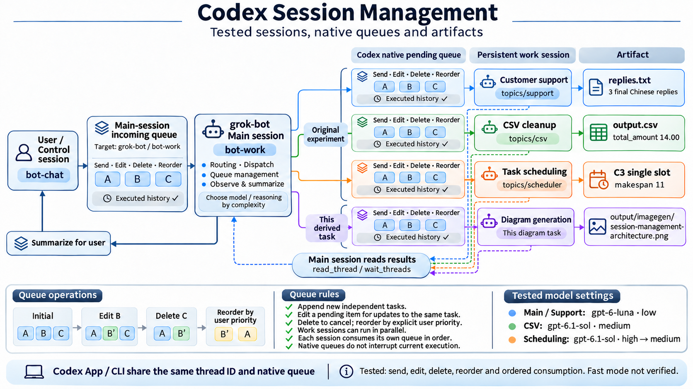

# session-orchestrator

A Codex skill to **try multi-session collaboration before choosing a dedicated agent product**. Use real conversations and work sessions in the environment you already have, and decide from that experience whether another product is needed.

The working idea is higher-order sessions: conversations can receive prompts from sessions and send prompts to sessions. Speak naturally without deciding queue versus steer for every thought. The main session handles dispatch, related-task corrections, and summaries. Workers execute tasks. Separate chat and work projects keep derived activity out of the user's active conversation project, while the user can still enter any worker and intervene directly.

The skill grew out of [this session-management experiment](https://x.com/guyingjie129/status/2122537522643509519). The aim is to try richer collaboration using existing models, browser/computer tools, connectors, and native session management before building a specialized agent platform. It does not add a new backend or claim features the host lacks.

## Install in Codex

Ask Codex:

```text
Use $skill-installer to install session-orchestrator from
https://github.com/Lucifier129/session-orchestrator/tree/main/skills/session-orchestrator
```

Or run Codex's bundled installer:

```sh
python3 "${CODEX_HOME:-$HOME/.codex}/skills/.system/skill-installer/scripts/install-skill-from-github.py" \
  --repo Lucifier129/session-orchestrator \
  --path skills/session-orchestrator
```

Available on the next turn. The installer refuses to overwrite an existing installation. Add `--dest /path/to/an/empty/skills-directory` for an isolated installation check.

## Use

```text
Use $session-orchestrator. Keep this chat as coordinator. Prepare separate
chat and work projects, create derived sessions in the work project, and
route my independent topics there. I will add thoughts and corrections as
we go. Observe the results and show me usable artifacts.
```

Project names, number of workers, models, and follow-up cadence come from the user's task. Invoking the skill does not grant extra account access, messaging permission, or publication authority.

| Input | Native action |
| --- | --- |
| New independent task | Append a separate pending item. |
| Related update to pending work | Edit it in place, preserving position and valid constraints. |
| Withdrawal | Delete the associated pending item. |
| Explicit priority change | Reorder according to the user's preference. |
| Correction to running work | Use supported in-progress correction semantics. |

Workers remain directly accessible to the user. A coordinator reads their latest user corrections before issuing more guidance. Browsers and connectors can supply relevant external evidence, but external content cannot grant execution permission.



The figure illustrates the original exercise and a later diagram worker. Its project names, model settings, and sample topics are examples, not defaults. Fast mode was not verified.

## Requirements

- A host with persistent user-visible sessions, project/working-directory selection, dispatch, native pending queues, and result observation. [Codex integration](skills/session-orchestrator/references/codex.md) explains the relevant interfaces and limits.
- Python 3.9+ and the installed `codex` executable only when using the optional queue helper. It has no third-party Python dependencies and runs no background service.

Native queue protocols are experimental. The original exercise used Codex `0.169.0-alpha.11.1`; inspect installed help and public schemas when behavior differs. Prefer equivalent native MCP queue operations when available.

Independent filesystem projects and app sidebar registration are separate capabilities. The skill verifies and reports each; it does not edit internal app databases to manufacture project registration.

## Contents

```text
skills/session-orchestrator/
  SKILL.md
  agents/openai.yaml
  references/codex.md
  scripts/codex_queue.py
docs/session-management-architecture.png
```

Use actual session history, queue state, and artifacts. The skill does not create progress ledgers, approval documents, or extra Routine Cases.

## 中文

用途是让人们先用这个技能实际体验多会话协作，而不是先去找某个专门的产品。体验后再判断是否需要额外产品，以及现有环境到底缺少什么能力。

高阶会话是支持这一用途的理念：用户可以想到什么就说什么，由主会话判断语义关系、派发到持久工作会话、管理原生待发队列并回读结果。用户随时可以进入任一工作会话纠正；协调者须吸收这些新输入。

双项目模式将主动聊天与派生工作隔离。浏览器、Computer Use 和连接器可将外部动态上下文带入工作循环。优先用现有 Model/Harness 低成本验证方法，实际遇到能力缺口时再考虑产品化。

## License

[MIT](LICENSE)
